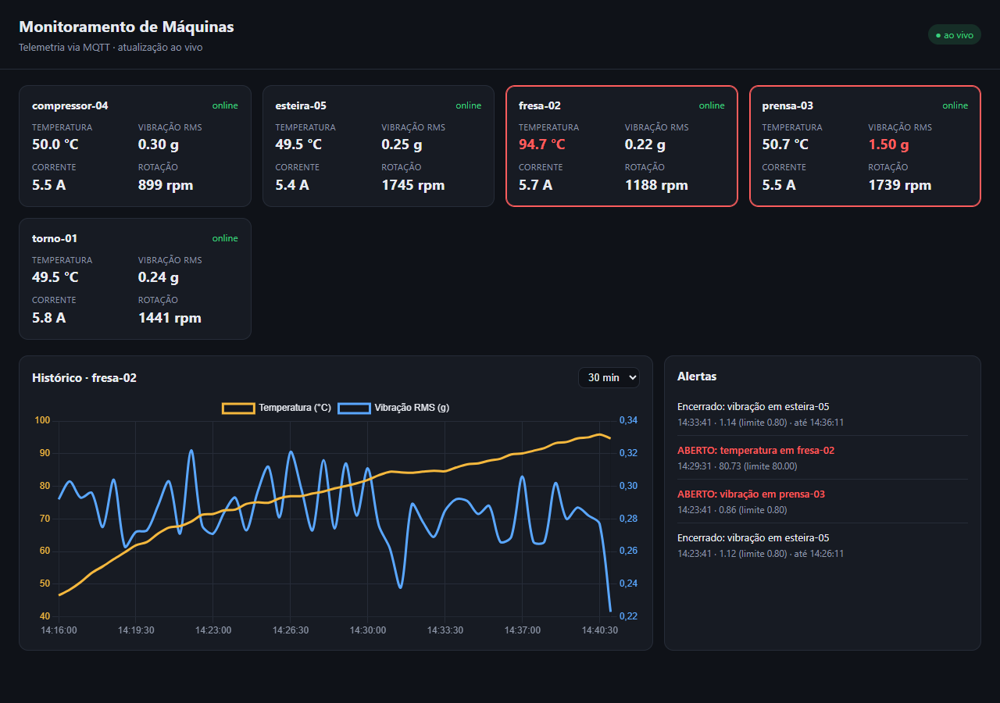
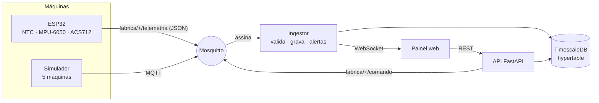

# Monitoramento de Máquinas (IoT)


Sistema **IoT de ponta a ponta** para monitorar máquinas industriais. O caminho completo:

1. Um **ESP32** lê temperatura, vibração, corrente e rotação.
2. Ele publica as leituras via **MQTT**.
3. Uma plataforma em **Python** grava tudo num banco de séries temporais (**TimescaleDB**).
4. A plataforma detecta anomalias com alertas.
5. Um **painel web atualiza ao vivo** por WebSocket.



> No print: a `fresa-02` está superaquecendo e a `prensa-03` está com o rolamento gasto, e os alertas abriram sozinhos. A `esteira-05` teve picos de vibração que abriram e fecharam alertas.

## Arquitetura



| Tópico MQTT | Direção | Conteúdo |
|---|---|---|
| `fabrica/<maquina>/telemetria` | ESP32 → broker | `{"maquina":"torno-01","temperatura_c":54.26,"vibracao_rms_g":0.312,"corrente_a":6.8,"rpm":1450}` |
| `fabrica/<maquina>/status` | ESP32 → broker | `online` / `offline`. O `offline` é o *last will*: o broker publica sozinho se o ESP32 cair |
| `fabrica/<maquina>/comando` | plataforma → ESP32 | `{"intervalo_ms": 2000}`: muda a frequência das leituras remotamente |

## Firmware (ESP32, C++)

| Sensor | Grandeza | Como é calculada |
|---|---|---|
| Termistor NTC 10k | Temperatura | Divisor de tensão no ADC e equação do parâmetro Beta |
| MPU-6050 (I2C) | Vibração | 200 amostras do módulo da aceleração a ~1 kHz, e RMS sem a componente da gravidade |
| ACS712-20A | Corrente | Sensor de efeito Hall, descontando o offset de 2,5 V |
| Sensor indutivo | Rotação | Pulsos contados por interrupção |

As conversões ficam em funções puras ([`Sensores.h`](firmware/lib/Sensores/src/Sensores.h)), testadas no PC com Unity. Os testes cobrem valores conhecidos do termistor, sensor desconectado, RMS, corrente e montagem do JSON. O Wi-Fi e o MQTT se reconectam sozinhos.

## Plataforma (Python)

- **Ingestão assíncrona** com `aiomqtt`:
  - valida cada mensagem com Pydantic
  - descarta JSON inválido ou mensagem cujo tópico não bate com a máquina
  - cadastra máquinas novas automaticamente
  - reconecta ao broker com espera crescente
- **TimescaleDB:** a tabela de leituras vira uma *hypertable* particionada por tempo. O histórico é agregado com `date_bin`, que também funciona em PostgreSQL puro
- **Alertas com histerese:** abrem depois de 3 leituras seguidas acima do limite e fecham depois de 3 abaixo, o que evita alarme "piscando". O estado sobrevive a reinícios, e um índice único parcial garante um único alerta aberto por máquina e tipo
- **API REST** (FastAPI, com documentação em `/docs`):
  - máquinas com a última leitura
  - histórico agregado
  - limites por máquina
  - alertas
  - envio de comando
- **Painel ao vivo:** WebSocket com gráfico de temperatura e vibração (Chart.js), destaque das máquinas em alerta e reconexão automática

## Como rodar

**Com Docker** (broker, TimescaleDB, plataforma e simulador):

```bash
docker compose up --build
```

Depois abra http://localhost:8000. Em poucos minutos as máquinas simuladas começam a disparar alertas.

**Com um ESP32 de verdade:**

```bash
cd firmware
cp include/secrets.example.h include/secrets.h   # Wi-Fi e IP do broker
pio run -e esp32dev -t upload
pio device monitor
```

Depois é só tirar o serviço `simulador` do compose.

## Testes

| Parte | O que é testado |
|---|---|
| Firmware (9 testes Unity) | Termistor (valor conhecido, curto e circuito aberto), RMS da vibração, MPU-6050, corrente, JSON e buffer pequeno |
| Alertas (7 testes) | Leitura isolada não dispara, abre com 3 seguidas, histerese no fechamento, limite exato, sensor com defeito, independência entre máquinas, restauração após reinício |
| Plataforma (11 testes, PostgreSQL real) | Cadastro automático, mensagens inválidas, abertura e fechamento de alertas, limites por máquina, histórico, *last will*, WebSocket, simulador, hypertable no TimescaleDB |
| Ponta a ponta | Simulador → **Mosquitto** → plataforma → banco |

O GitHub Actions roda os testes do firmware e **compila para ESP32**, depois roda os testes da plataforma contra **TimescaleDB e Mosquitto reais**, faz lint e constrói a imagem Docker.

---

<details>
<summary>English</summary>

### Machine Monitoring (end-to-end IoT)

ESP32 firmware (C++/PlatformIO) reads temperature (NTC thermistor, Beta equation), vibration (MPU-6050, RMS without gravity), current (ACS712) and speed, and publishes JSON over **MQTT** with last-will online/offline status and remote commands. A **Python/FastAPI** platform ingests messages asynchronously (aiomqtt + Pydantic validation), stores them in a **TimescaleDB** hypertable, raises alerts with hysteresis, and streams to a live **WebSocket dashboard** (Chart.js). Includes a machine simulator with failure modes, Docker Compose (Mosquitto, TimescaleDB, platform, simulator) and CI that unit-tests the firmware, builds it for ESP32 and runs end-to-end tests against real Mosquitto and TimescaleDB.

</details>
